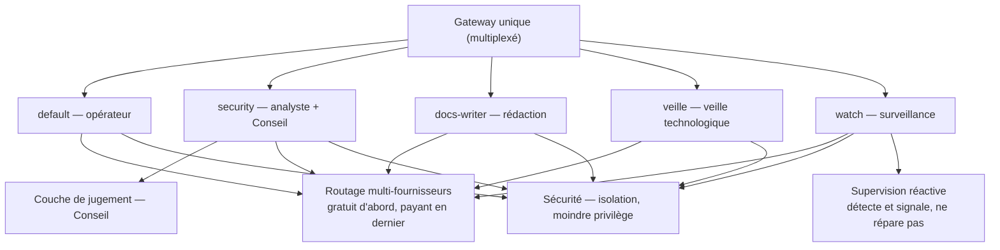
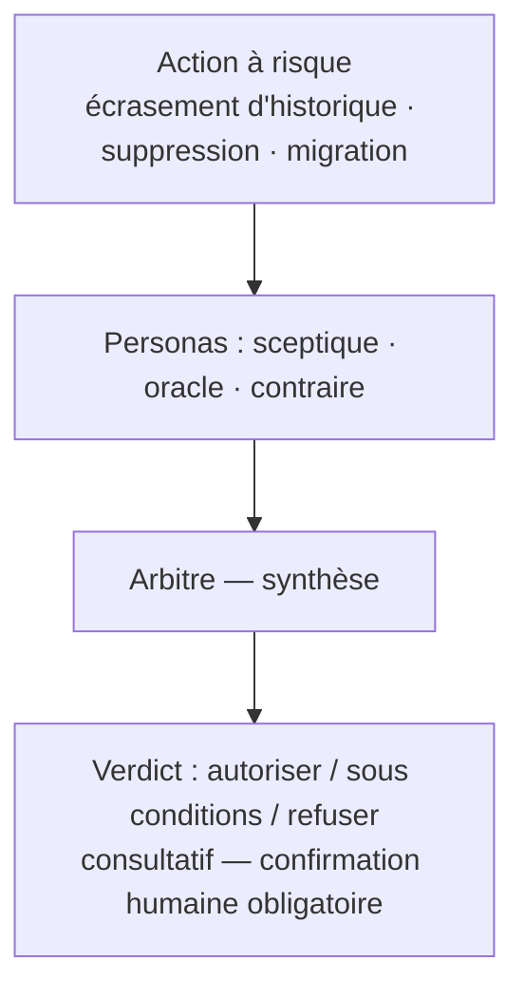

# Hermes Home Vision

Aperçu public d'une infrastructure d'exploitation d'un assistant IA (Hermes Agent) en profils
isolés : routage multi-fournisseurs, supervision continue, couche de jugement (Conseil) et second
cerveau. Ce dépôt est la vue publique ; le dépôt d'exploitation détaillé reste privé.
Projet personnel, non affilié aux éditeurs de Hermes Agent.

## Vue d'ensemble

Un gateway unique (multiplexé) sert plusieurs profils isolés, chacun avec sa configuration et ses
secrets dédiés :

| Profil | Rôle |
|---|---|
| `default` | opérateur : code, vidéo, publication, second cerveau |
| `security` | analyste sécurité + couche de jugement (Conseil) |
| `docs-writer` | rédaction documentaire |
| `veille` | veille technologique (arXiv, HuggingFace, flux) |
| `watch` | surveillance et automatisations |

## Architecture

## Couche Conseil (jugement avant action)

Une couche de délibération antagoniste peut être consultée avant une action à risque :

- des « personas » débattent de l'action (sceptique, oracle, contraire), puis un arbitre synthétise ;
- le verdict — autoriser, autoriser sous conditions, ou refuser — est **consultatif** : il informe
  la décision, il ne remplace pas la confirmation humaine ;
- pour toute action **irréversible** (écrasement d'historique, suppression, migration), la
  **confirmation humaine est obligatoire** quel que soit le verdict.

## Sécurité (principes généraux)

- Chaque profil est isolé : configuration et secrets dédiés ; un canal de messagerie ne sert qu'un
  profil.
- Les secrets ne sont jamais versionnés dans le dépôt.
- Principe du moindre privilège : chaque accès est restreint au strict nécessaire.
- Les services n'écoutent que sur l'interface locale.

## Principe d'installation (le dépôt d'exploitation n'est pas publié)

Ce dépôt ne contient pas les éléments exécutables : le dépôt d'exploitation complet
(configurations, scripts, données) reste privé. Le principe :

- l'assistant s'installe sur un poste dédié, sans droits administrateur ;
- la configuration d'exploitation est clonée depuis le dépôt privé dans le répertoire d'exécution ;
- les secrets sont créés localement par profil, à partir de modèles, jamais versionnés ;
- un script d'amorçage reconstruit l'installation (mode simulation par défaut, exécution sur
  demande explicite).

## Limites connues

- Les verdicts du Conseil reposent sur des modèles gratuits : un verdict isolé est indicatif ; une
  distribution de plusieurs appels fait foi.
- La confiance annoncée par le Conseil n'est pas calibrée (usage ordinal, pas une probabilité réelle).
- Certains modèles gratuits de repli sont instables (erreurs temporaires) : ils ne servent que de
  secours, jamais de cible nominale.

## Licence

Licence à choisir (aucune retenue par défaut) :

- **Option 1 — MIT** : réutilisation libre, modification et redistribution autorisées avec mention
  d'attribution.
- **Option 2 — CC BY 4.0** : réutilisation et adaptation autorisées avec attribution.
- **Option 3 — Tous droits réservés** : dépôt public à titre documentaire ; aucune licence
  d'utilisation, de modification ou de redistribution n'est accordée.

Le fichier `LICENSE` correspondant sera ajouté au choix retenu.

### 📊 Schéma interactif
👉 [**Consulter l'Architecture interactive Hermes sur Claude.ai**](https://claude.ai/public/artifacts/044f4498-e9a7-457b-b044-d4a99544b8b9)

- Site : <https://searching-murphy.com>
- GitHub : <https://github.com>
- Agensi (skills commerciaux) : <https://agensi.io>

